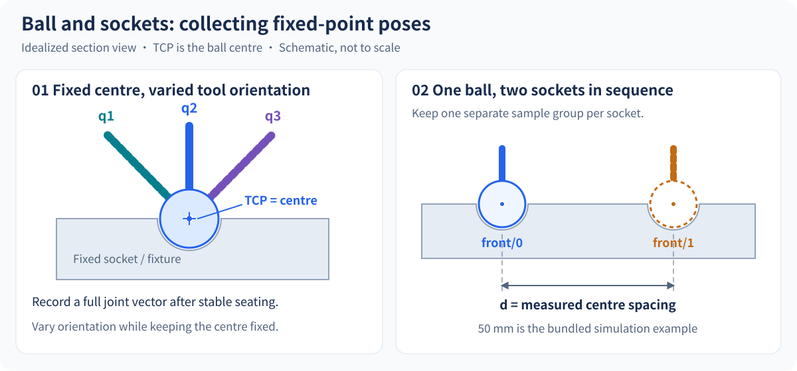
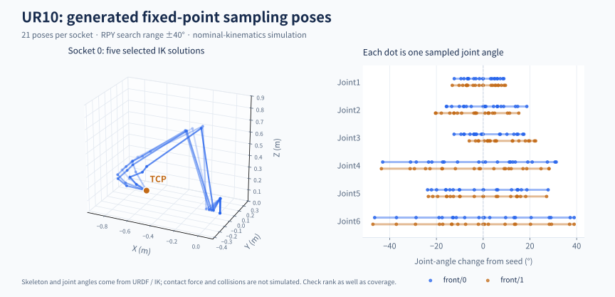
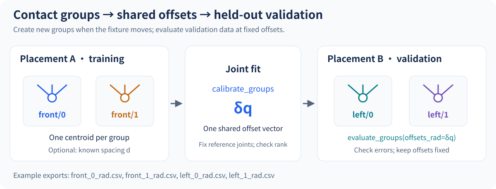

# PointZeroCal

[简体中文](README.zh-CN.md) | English

PointZeroCal is a joint zero-offset calibration library built on [Pinocchio](https://github.com/stack-of-tasks/pinocchio). It estimates encoder zero offsets from configurations collected while the TCP touches fixed points. It supports multiple contact groups, known socket distances, and evaluation at independent fixture placements with fixed parameters.

[Sampling guide](#sampling-guide) · [Data requirements](#data-requirements) · [Multiple contacts](#multiple-contacts-and-known-distances) · [UR10 simulation](#ur10--viser-simulation)


## Why PointZeroCal

- **Backend-independent solver:** use the included Pinocchio adapter or provide a small position-and-Jacobian interface.
- **Observability diagnostics:** effective rank, singular values, condition number, and active-joint reporting make underconstrained setups explicit.
- **Practical interfaces:** typed Python API, strict JSON CLI output, degree/radian input, fixed-joint selection, and optional TCP transforms.
- **Joint fitting across sockets:** separately centre each contact group, share offsets, and optionally constrain known distances.
- **Reproducible validation:** deterministic analytical tests, axial/eccentric TCP comparisons, and noisy two-socket calibration with a held-out placement.

## Calibration principle

Collect diverse robot configurations while the TCP touches one physical point. The solver iteratively finds a shared joint-offset vector that minimizes the centered TCP position residual. A reference joint must remain fixed because fixed-point position measurements cannot identify a global base rotation.


## Installation

```bash
python -m pip install -e .
# Development and tests
python -m pip install -e '.[test]'
pytest
```

## Quick start

Run the bundled UR10 example without starting the viewer:

```bash
python -m pip install -e .
python examples/ur10_calibration_demo.py --no-viewer
# Two sockets, encoder noise, and a held-out validation placement
python examples/ur10_two_socket_demo.py
```

## Sampling guide



1. **Define the ball-centre TCP.** Secure the ball to the tool and set the model's TCP translation to its centre. Keep the fixture stationary throughout a contact group.
2. **Record socket 0.** Once the ball is stably seated and the robot is stationary, record all actuated joint angles. Repeat at varied tool orientations and joint configurations.
3. **Record socket 1.** Use the same ball and a separate CSV. If using a distance constraint, record the measured centre spacing; 50 mm in the figure is the simulation example.
4. **Hold out another placement.** Move the fixture, assign new group names, and evaluate the fitted offsets on these observations while keeping parameters fixed.

`fixed_joints` holds the **estimated offsets** fixed. These joints may still move during sampling and must remain in the CSV. Seating clearance, motion during recording, and load-induced deflection affect the fixed-point assumption; review large residuals against the collection notes.



This figure is computed from the bundled URDF and IK using an eccentric TCP `(0.08, 0, 0.16) m`. The two-socket example generates 21 poses per socket within an RPY search range of ±40°; the skeleton view shows five solutions at socket 0. It illustrates kinematic sampling without contact-force or collision simulation. SVGs can be enlarged; [figure sources and regeneration instructions](docs/assets/README.md) are included.

| Sampling check | What to inspect |
| --- | --- |
| Sufficient configurations | Joint coverage, effective rank, and singular values. The example's 21 poses are a setting; the API minimum of two rows is only input validation. |
| Unobservable joints | Fixed-point positions retain the global base-rotation ambiguity; a ball centre on the wrist axis also leaves that offset unobservable. |
| Samples to review | Per-group sample residuals and `worst_sample_csv_row`, alongside seating, stationary-state, and collection notes. |
| Performance elsewhere | Hold offsets fixed and compare nominal/corrected RMS and distance errors at an independent placement. |

## Data requirements

Each CSV row is one joint configuration. Without a header, columns must follow the actuated-joint order in the URDF. For a CSV with joint names on its first data row, pass `--csv-header`: columns are reordered to model order, and missing, duplicate, or unknown names are rejected. Header detection is explicit so the first numeric sample is never silently discarded.

The reader accepts UTF-8 (including a BOM), quoted fields, blank lines, and unquoted `#` comments. Each configuration occupies one physical line. Invalid values identify the source line, column, and joint. Use widely distributed poses for observability. Each group must touch the same stationary physical point; use `calibrate_groups` for multiple contact points. The CLI continues to accept a single contact CSV.

For one group without distance constraints, identical configurations report rank 0, even when only one joint is being estimated. Known distances between groups can provide additional constraints. Samples, offset seeds, and backend outputs must be real-valued; complex or non-finite inputs are rejected.

## Command line

```bash
point-zero-cal \
  --urdf robot.urdf \
  --end-frame tool_tip \
  --tcp-xyz 0.08 0.0 0.16 \
  --samples contact_samples.csv \
  --unit deg \
  --fixed-joint joint1
```

Add `--csv-header` for named columns, for example a file starting with `joint2,joint1,...` in a different order from the model. This also supports the named-header format exported by MUKCa's ROS 2 recorder when its joint set matches the model; select `--unit rad` for recorded revolute-joint positions. See the [design review](docs/kinematics_calibration_design_review.md) for the scope of compatibility.

Results are printed to the terminal by default. Add `--output calibration.json` only when persistence is needed. `--tcp-xyz` defines the TCP translation in the end frame; `--tcp-rpy` defines its orientation in radians. Fixed-point contact cannot identify the global base rotation, so the first actuated joint is fixed by default. Repeat `--fixed-joint` to override that default. Exit code 0 means convergence; code 2 indicates non-convergence or insufficient rank.

The CLI defaults to degree input; the Python API defaults to radians. Set `--residual-tolerance` to the acceptable point RMS in **metres** for your measurement setup, for example `--residual-tolerance 0.0001` for 0.1 mm. `--step-tolerance` (radians), `--damping`, `--rank-tolerance` (relative singular-value cutoff), and `--max-iterations` expose the solver settings. Tolerances must be finite and positive, damping may be zero, and rank tolerance must be below 1. Invalid inputs or output-file errors exit with code 2 and a message on stderr. Rank-deficient condition numbers are represented by JSON `null`.

`--output` must differ from both the sample CSV and URDF, including symbolic or hard links to those inputs. JSON reports are written to a temporary file in the destination directory, then replaced atomically after the write completes. A failed write leaves an existing report intact; the destination directory must already exist. Existing report permissions and symbolic links are preserved.

For multiple contact groups, replace `--samples` with repeatable `--group NAME=PATH` entries plus optional known distances and held-out validation groups:

```bash
point-zero-cal --urdf robot.urdf --end-frame tool_tip --tcp-xyz 0.08 0.0 0.16 --unit rad \
  --group front0=front_0_rad.csv --group front1=front_1_rad.csv \
  --distance front0 front1 0.05 \
  --validate-group left0=left_0_rad.csv --validate-group left1=left_1_rad.csv \
  --validate-distance left0 left1 0.05
```

`--group-sigma NAME=SIGMA` and `--distance-sigma FIRST SECOND SIGMA` add optional one-sigma measurement uncertainties in metres; `--distance-weight FIRST SECOND WEIGHT` sets a positive distance weight. `--csv-header` applies to every CSV, and group names must be unique across training and validation. Validation groups are evaluated at the fitted offsets without refitting; the report adds `validation_evaluation` and `validation_passed`, and the exit code is 0 only when the fit converges and validation (when present) passes.

## Python API

```python
import numpy as np
from point_zero_cal import JointZeroCalibrator, PinocchioKinematics, load_samples_csv

kinematics = PinocchioKinematics("robot.urdf", "tool_tip", tcp_xyz=(0.08, 0.0, 0.16))
table = load_samples_csv("contact_samples.csv", kinematics.joint_names)
samples = table.values
result = JointZeroCalibrator(kinematics).calibrate(
    samples, sample_unit="deg", fixed_joints=["joint1"]
)
print(result.converged, result.offsets_deg)
# Apply the estimated correction to measured joint angles.
corrected_rad = np.deg2rad(samples) + result.offsets_rad
```

Use `header=True` in `load_samples_csv` for named columns. It returns a `SampleTable` with read-only `values` in model joint order, `joint_names`, and one-based physical `csv_rows`. The loader preserves input units; set `sample_unit` when calibrating. The numerical API also continues to accept arrays directly.

The current implementation supports fixed-base URDF models with bounded revolute joints and one configuration variable per actuated joint. Floating-base, multi-DoF, and continuous joints with multi-variable configurations are rejected. Prismatic joints are also rejected because the calibration API expresses every offset in radians.

Results include a status message, sample count, active joints, point RMS before and after calibration, effective rank, condition number, and singular values. Diagnostics are recomputed after the final update. Input shapes, finite values, TCP parameters, and Pinocchio backend outputs are validated.

Single-point `calibrate` results also include `sample_diagnostics`, computed from cached positions without additional kinematics calls. Its read-only arrays contain `contact_point_xyz` (the final sample centroid in the backend's world frame), `initial_point_errors`, and `corrected_point_errors`, all in metres. Distances preserve input sample order; initial distances include any offset seed. `max_corrected_point_error` and `worst_sample_index` locate the largest corrected residual. The index is **zero-based**, while the demo's printed sample number starts at 1. The largest residual identifies a sample to review; interpretation requires the collection context.

Use `result.to_dict()` to serialize API results with the same diagnostics as the CLI, for example `json.dumps(result.to_dict(), allow_nan=False)` after importing `json`. The CLI additionally includes all `joint_names` and `sample_csv_rows`, and adds `worst_sample_csv_row` to `sample_diagnostics`. These CSV row numbers start at 1 and include header, comment, and blank lines, so they can be used to find samples in the original file. Nested JSON keys use explicit metre suffixes: `contact_point_xyz_m`, `initial_point_errors_m`, `corrected_point_errors_m`, and `max_corrected_point_error_m`.

`step_norm` is the infinity norm of the estimated **remaining undamped correction at the returned offsets**, in radians. This lets a solution reached on the last allowed update report convergence, and prevents a large damping value from satisfying the step criterion merely by suppressing movement. Centering removes a common baseline before averaging, and RMS uses scaled accumulation to avoid artificial rank and overflow/underflow from direct squaring.

The solver uses damped SVD updates with the same observability cutoff as the diagnostics, and backtracks steps that would increase point RMS. A stationary fit stops early even when noise prevents reaching the requested residual tolerance; `converged` remains false unless rank, residual, and step criteria all pass. This is a local solver, so diverse poses and a reasonable offset seed still matter. `initial_offsets` always uses radians, including for degree samples, and fixed joints retain their seeded offsets. Result arrays are read-only; use `.copy()` when a writable array is needed.

Custom backends implement `dof`, `joint_names`, and `position_and_jacobian(q)` returning a position `(3,)` in metres and Jacobian `(3, dof)` in m/rad. Returned buffers may be reused across calls. The Pinocchio adapter also provides `tcp_pose_and_jacobian(q)` for a TCP pose and a world-aligned `(6, dof)` Jacobian, with linear rows first, for simulation and diagnostics.

## Multiple contacts and known distances



Use a separate `ContactGroup` for each stationary socket at each fixture placement. All groups share the estimated offsets, while each has its own fitted centroid. The TCP transform must locate the ball centre. Record a new group after moving the fixture; retain joint order and a common sample unit across groups.

Run this complete example from the repository root. First generate four named radian CSVs and a synthetic-data report:

```bash
python examples/ur10_two_socket_demo.py --output-dir two_socket_output
```

```python
from pathlib import Path
from point_zero_cal import (
    ContactGroup,
    JointZeroCalibrator,
    KnownDistance,
    PinocchioKinematics,
    load_samples_csv,
)

kinematics = PinocchioKinematics(
    "assets/UR10/UR10.urdf", "ee_link", tcp_xyz=(0.08, 0, 0.16)
)
data_dir = Path("two_socket_output")


def read_contact(name, filename):
    table = load_samples_csv(data_dir / filename, kinematics.joint_names, header=True)
    return ContactGroup(name, table.values, csv_rows=table.csv_rows)


training = [
    read_contact("front/0", "front_0_rad.csv"),
    read_contact("front/1", "front_1_rad.csv"),
]
solver = JointZeroCalibrator(kinematics, residual_tolerance=0.0001)
result = solver.calibrate_groups(
    training,
    distances=[KnownDistance("front/0", "front/1", distance_m=0.05)],
    sample_unit="rad",
    distance_tolerance=0.0001,
)
if not result.converged:
    raise RuntimeError(result.message)

validation = [
    read_contact("left/0", "left_0_rad.csv"),
    read_contact("left/1", "left_1_rad.csv"),
]
validation_distances = [KnownDistance("left/0", "left/1", distance_m=0.05)]
nominal = solver.evaluate_groups(
    validation,
    offsets_rad=[0] * kinematics.dof,
    distances=validation_distances,
)
check = solver.evaluate_groups(
    validation,
    offsets_rad=result.offsets_rad,
    distances=validation_distances,
)
print(
    "Validation RMS (mm):", nominal.point_rms_m * 1000, "->", check.point_rms_m * 1000
)
print("Distance error (mm):", check.distances[0].error_m * 1000)
```

Replace 0.05 m with the measured centre spacing. Distances are optional and have a positive dimensionless `weight` (default 1). The squared objective is `mean(group_point_rms_m**2) + sum(weight * distance_error_m**2)`. Groups have equal overall weight regardless of sample count. The grouped solver reuses the single-point SVD and backtracking implementation; one group without distances or `sigma_m` produces the same solve as `calibrate`. A single group with `sigma_m` uses the weighted system, including its effect on damping and reported singular values; physical residual tolerances remain in metres.

Optional `sigma_m` fields describe one-sigma measurement uncertainty in metres: `ContactGroup(..., sigma_m=...)` downweights a noisier group's consistency residual, and `KnownDistance(..., sigma_m=...)` scales the distance residual by `1/sigma`. `None` (the default) keeps the equal weighting above. Acceptance criteria always check the physical, unweighted errors, so a large sigma cannot hide an out-of-tolerance group or distance. Sigma values appear in the evaluation reports and JSON output, and candidate ranking honours them.

Convergence requires full active rank, a small remaining offset correction, **each group's** point RMS within `residual_tolerance`, and **each unweighted distance error** within `distance_tolerance` (defaults to residual tolerance). A small weight cannot hide an unacceptable distance error. Distinct endpoints and unique group names are required; coincident predicted centres cannot be linearized for a positive distance and require a different seed or corrected observations.

Grouped results expose `initial_evaluation` and `evaluation`, also included in `to_dict()`. Their `groups` report centroids, point RMS, per-sample errors and optional CSV rows; `distances` report signed predicted-minus-measured errors. `corrected_point_rms` equally weights groups, while `residual_rms` additionally includes distances. `sample_diagnostics` remains specific to the single-point API.

`evaluate_groups` holds offsets fixed and never runs parameter optimization. Supply observations from independent placements or sessions and compare nominal and corrected parameters on the same validation data. Centroids are inferred from validation samples, so this evaluates consistency and relative distances, not absolute TCP accuracy against a world reference. Distance constraints preserve the global frame ambiguity and do not make an axial TCP sensitive to wrist rotation. Geometric (URDF origin) parameter fitting is a separate model described in the next section.

The default synthetic case reduces held-out point RMS from about 3.40 mm to 0.0363 mm. This is a simulation result, not a hardware accuracy claim. Use `--encoder-noise-deg 0` for a noiseless check or `--orientation-count 31` to change the number of poses per socket. The simulation helper `generate_fixed_point_dataset(..., target_xyz=...)` accepts an explicit contact position in metres.

## Geometric (URDF origin) calibration

Joint zero offsets and mounting/link-origin deviations are separate models. `GeometricCalibrator` fits deviations of selected URDF `<origin>` components (x/y/z in metres, roll/pitch/yaw in radians) from the same grouped contact data, with per-parameter activity masks, prior scales, and optional bounds:

```python
from point_zero_cal import (
    GeometricCalibrator,
    GeometricParameter,
    KnownDistance,
    PinocchioGeometricKinematics,
    export_calibrated_urdf,
    geometric_origin_updates,
)

backend = PinocchioGeometricKinematics(
    "robot.urdf",
    "tool_tip",
    [GeometricParameter("tool_mount", c, prior_scale=0.1) for c in ("x", "y", "z")],
    tcp_xyz=(0.08, 0.0, 0.16),
)
fit = GeometricCalibrator(backend, residual_tolerance=0.0001).calibrate_groups(
    training, distances=[KnownDistance("front/0", "front/1", 0.05)]
)
export_calibrated_urdf(
    "robot.urdf",
    "robot_calibrated.urdf",
    geometric_origin_updates("robot.urdf", fit.parameters),
    metadata={"message": fit.message, "converged": fit.converged},
)
```

`GeometricParameter` carries the owning joint, component, unit, `nominal` (deviation default 0), `active` mask, required positive `prior_scale` in the component's unit, and optional `lower`/`upper` bounds. Parameters may target revolute joints or single-level fixed joints (a typical tool mount); chained fixed joints are rejected because their folded placements no longer map to one origin. The backend reports analytic TCP derivatives, validated against rebuilt perturbed URDFs in the test suite.

The objective adds one normalized prior row per active parameter, `(x - nominal) / prior_scale`, on the same scale as distance rows; observability diagnostics (`data_rank`, `data_condition_number`, `singular_values`, `nullspace_directions`) use the contact and distance rows only, so priors can never fake full rank. Convergence requires full data rank, physical group/distance tolerances, a small remaining step, and no stall. Bounds clamp accepted candidates. `evaluate_groups` evaluates fixed parameter vectors on held-out groups without fitting.

Fixed-point consistency sees each parameter only through its non-rigid TCP effect, so priors compete with the data through the Jacobian: generous `prior_scale` values let the contact data dominate, tight ones hold parameters near nominal. The reported data-only singular values quantify that leverage. Zero offsets are never estimated together with mounting rotations — an origin rotation about a joint's own axis is exactly equivalent to that joint's zero offset.

`export_calibrated_urdf` writes a new file (the source is never modified), preserves XML comments, rewrites only the requested origin components with absolute values, and embeds parameters, solver state and validation results as an escaped-JSON XML comment, so the exported model stays loadable by standard URDF parsers. Run `python examples/ur10_geometric_demo.py` for a synthetic two-socket recovery of injected TCP-mounting translations, including a tight-prior comparison, held-out validation, and calibrated URDF export.

## UR10 + Viser simulation

The repository includes two comparison cases using `assets/UR10/UR10.urdf`. Both keep TCP XYZ fixed while varying RPY and use Pinocchio IK to generate configurations. The default set contains 41 poses spanning ±60°. Approximate joint ranges in the lateral-TCP case are `[35°, 47°, 44°, 115°, 96°, 147°]`.

- Axial TCP `(0, 0, 0.16)`: Joint6 is unobservable; Joint1 and Joint6 are fixed while Joint2–Joint5 are validated.
- Lateral eccentric TCP `(0.08, 0, 0.16)`: `X=0.08 m` provides a lever arm perpendicular to the Joint6 axis, making its translational Jacobian nonzero. Only Joint1 is fixed while Joint2–Joint6 are validated.

Install simulation dependencies:

```bash
python -m pip install -e '.[simulation]'
```

Run calibration and print results without writing files:

```bash
python examples/ur10_calibration_demo.py --no-viewer
```

Start Viser and use the `TCP case` dropdown and `Contact pose` slider:

```bash
python examples/ur10_calibration_demo.py
```

The pose count must be an odd integer of at least 3. Count and orientation range are configurable:

```bash
python examples/ur10_calibration_demo.py \
  --no-viewer \
  --orientation-count 49 \
  --orientation-range-deg 45
```

If the TCP lies on the Joint6 axis, fixed-point XYZ contact alone cannot identify the Joint6 offset. Use an eccentric tool or an additional orientation measurement. A relative singular-value threshold prevents floating-point noise from being mistaken for observable rank.

The demo deliberately injects Joint2–Joint6 offsets of `[+1.2°, -0.8°, +1.5°, -1.0°, +2.0°]`. The lateral-TCP case recovers all five offsets and reduces point-cloud RMS from about `4.57 mm` to numerical precision. The axial-TCP case recovers Joint2–Joint5 while retaining the unobservable Joint6 error.

Key report fields:

- `Injected`, `Estimated`, `Error`: known, recovered, and estimation-error offsets.
- `State`: whether a joint was calibrated, fixed as a reference, or unobservable.
- `Point RMS`: TCP dispersion before and after correction.
- `Rank`: number of observable joints.
- `Condition no.`: a lower value generally indicates better sample excitation.

### Optional result export

Files are written only when `--output-dir` is supplied:

```bash
python examples/ur10_calibration_demo.py \
  --no-viewer \
  --output-dir calibration_output
```

This creates `*_measured_deg.csv` simulated encoder samples and `*_result.json` calibration reports for both TCP cases.

## Design references

The [kinematics_calibration design review (Chinese)](docs/kinematics_calibration_design_review.md) compares MUKCa's grouped contacts, known-distance constraints, geometric parameters, and held-out validation with PointZeroCal. It records the proposed extension order and clearly separates existing features from future work.
