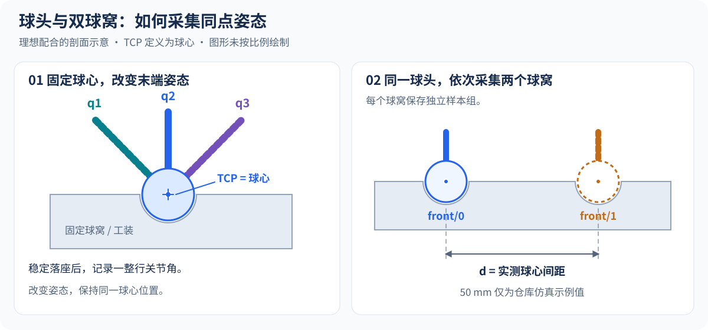

# PointZeroCal

[English](README.md) | 简体中文

通过工具中心点（TCP）接触固定点时采集的机器人姿态，估计关节零偏。提供基于 Pinocchio 的运动学后端、独立数值求解器和输出 JSON 的命令行工具。

支持多接触组、已知球窝间距、URDF origin 几何标定，以及独立观测验证。报告包含可观秩、奇异值、条件数和逐样本残差。

## 安装与体验

需要 Python 3.10+。在仓库根目录运行，安装时会提供 NumPy 和 Pinocchio。

```bash
python -m pip install -e .
python examples/ur10_calibration_demo.py --no-viewer
python examples/ur10_two_socket_demo.py
```

UR10 示例对比轴向与偏心 TCP，再用带编码器噪声的双球窝数据标定，并在独立工装位置验证。默认双球窝仿真的独立点云 RMS 约从 **3.40 mm 降至 0.036 mm**。

查看交互仿真：先运行 `python -m pip install -e '.[simulation]'`，再运行 `python examples/ur10_calibration_demo.py`。

## 采集数据



1. 将工具上固定球头的球心设为 TCP。
2. 球头稳定落座于一个静止球窝，改变工具姿态并记录完整关节角。
3. 每个球窝或工装位置分别保存 CSV，可选测量球窝中心间距。
4. 留出独立工装位置，用拟合后的固定参数验证。

CSV 每行包含全部驱动关节角，列按 URDF 关节顺序排列；带关节名表头时使用 `--csv-header`。固定关节仍需出现在 CSV 中，采样时也可以运动；固定的是其待估计零偏。

## 命令行

使用自己的机器人模型与带关节名表头的采集文件：

```bash
point-zero-cal --urdf robot.urdf --end-frame tool_tip \
  --samples samples.csv --csv-header --unit deg \
  --tcp-xyz 0.08 0 0.16 --residual-tolerance 0.0001
```

结果以 JSON 输出到终端。添加 `--output calibration.json` 保存报告，无表头 CSV 省略 `--csv-header`。默认固定首个驱动关节，重复传入 `--fixed-joint NAME` 可指定参考关节。退出码 0 表示收敛且所提供的独立验证通过，2 表示未通过或输入有误。

多接触组与独立验证：

```bash
point-zero-cal --urdf robot.urdf --end-frame tool_tip --csv-header --unit rad \
  --tcp-xyz 0.08 0 0.16 \
  --group front0=front_0_rad.csv --group front1=front_1_rad.csv \
  --distance front0 front1 0.05 \
  --validate-group left0=left_0_rad.csv --validate-group left1=left_1_rad.csv \
  --validate-distance left0 left1 0.05
```

将 `0.05` 替换为实测中心间距，单位为米。噪声权重、容差等选项见 `point-zero-cal --help`。

## Python API

```python
import numpy as np
from point_zero_cal import JointZeroCalibrator, PinocchioKinematics, load_samples_csv

model = PinocchioKinematics("robot.urdf", "tool_tip", tcp_xyz=(0.08, 0, 0.16))
table = load_samples_csv("samples.csv", model.joint_names, header=True)
fit = JointZeroCalibrator(model).calibrate(table.values, sample_unit="deg")
if not fit.converged:
    raise RuntimeError(fit.message)
corrected_rad = np.deg2rad(table.values) + fit.offsets_rad
print(fit.offsets_deg, fit.corrected_point_rms)
```

CLI 默认使用度，Python API 默认使用弧度。TCP 平移、距离和残差容差使用米。修正关节角时，将 `offsets_rad` 加到弧度制采集值上。

多接触组与间距使用 `calibrate_groups`，固定参数验证使用 `evaluate_groups`，所选 origin 偏差使用 `GeometricCalibrator`。完整示例、自定义后端、不确定度加权和 URDF 导出见[使用指南](docs/usage.zh-CN.md)。

## 适用范围与验证

- Pinocchio 后端支持固定基座、带限位的单自由度旋转关节模型。
- 固定点测量保留整体基座旋转自由度；TCP 位于腕轴上时，该腕轴零偏也不可观。应检查秩与姿态覆盖。
- 独立点云 RMS 衡量接触一致性及相对间距。用独立观测评价拟合结果；仓库示例给出的是仿真结果。

```bash
python -m pip install -e '.[test]'
pytest
python -m compileall point_zero_cal tests
```

[使用指南](docs/usage.zh-CN.md) · [数值与性能记录](docs/optimization-notes.md) · [设计对照](docs/kinematics_calibration_design_review.md) · [图示来源](docs/assets/README.md)
