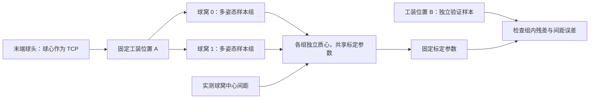

# 纳入 kinematics_calibration 的设计参考

审阅日期：2026-09-05。参考本地仓库 `/home/ubuntu/workspace/3rdparty/kinematics_calibration`，提交 `58cb04a203d3bd5694677d8e8248ef7240feb343`。本文依据源码静态审阅和 CSV 读取验证，不代表复现了其优化结果或硬件精度。

## 结论与边界

应将 MUKCa / kinematics_calibration 纳入 PointZeroCal 的设计参考。已在关节零偏 API 中实现多接触点分组、已知间距约束和固定参数的独立验证，并复用现有 SVD、回溯及可观性诊断；测量噪声尺度（σ 加权）、几何参数标定（先验/边界/导出）与多接触组 CLI 亦已实现。几何导出只重写所选关节的 origin 分量，保留名义模型并携带可追溯元数据。

| 方面 | PointZeroCal 当前实现 | 参考仓库实现 | 对后续设计的影响 |
| --- | --- | --- | --- |
| 待估参数 | 每个活动关节一个角度零偏，单位 rad | 每个选中关节的 URDF `origin.xyz/rpy`，共六个参数 | 几何标定应有单独的参数模型和雅可比接口 |
| 接触约束 | 多个具名接触组，分别中心化，共享零偏 | 每个工装位置两个球窝，各自质心；支持多个工装位置 | 用显式接触组共享一套参数，组内分别中心化 |
| 尺度约束 | 可选已知中心距离、权重和独立误差容差 | 两球窝质心间距与工装已知距离比较，默认 0.05 m | 距离应作为可选测量及其不确定度输入 |
| 求解 | Pinocchio 运动学、SVD、回溯、有效秩诊断 | CasADi 符号 FK 与 IPOPT，加入名义参数正则项 | 保留数值核心的后端独立性；扩参前明确尺度和可观性 |
| 评估 | 单点/分组残差、距离误差、固定零偏验证、UR10 仿真 | 训练位置与其他位置的曲线、组内一致性和间距误差 | 优先增加固定参数的独立验证，再扩展参数数量 |
| 产物 | 零偏及 JSON 诊断 | 优化后的 URDF 与中间迭代、配置、指标 | 几何模型导出需关联名义模型、数据和验证报告 |

参数定义见 [create_parameters](/home/ubuntu/workspace/3rdparty/kinematics_calibration/calibrate_fk/parameter_optimizer.py:143)，分组目标及间距项见 [动态质心目标](/home/ubuntu/workspace/3rdparty/kinematics_calibration/calibrate_fk/parameter_optimizer.py:223)，训练/验证划分见 [generate_learning_curve.py](/home/ubuntu/workspace/3rdparty/kinematics_calibration/scripts/generate_learning_curve.py:37)。

## 球头与球窝的工装采样设计

参考工装在机器人末端安装凸球头，在固定底座上设置两个凹球窝；其 [README](/home/ubuntu/workspace/3rdparty/kinematics_calibration/README.md:10)给出的名义中心间距为 50 mm，并提供 [MUKCa_tool.stl](/home/ubuntu/workspace/3rdparty/kinematics_calibration/stl/MUKCa_tool.stl)。理想配合下，球头在球窝内转动时球心位置不变，使“同一点、不同关节姿态”的采集更直接。每个球窝提供组内一致性约束，两个球窝的中心间距提供额外的距离约束。

以下流程的分组拟合、距离项和固定零偏验证已有 Python API 与仿真示例，实物采集仍由使用者提供：



实施时应将以下因素纳入采集记录和验证，而非仅增加样本数量：

- **TCP 定义：** 模型中的 TCP 必须是球心，安装变换应已知且稳定。当前零偏求解器不会同时估计球头安装误差。
- **姿态覆盖：** 在球头保持落座、连接杆允许的角度范围内改变姿态，检查关节跨度与有效秩。参考流程建议每窝至少 20 组姿态，这只是采集起点，不保证参数可观。
- **末轴力臂：** 球心位于末轴轴线上时，纯位置接触无法辨识该轴零偏。若需要估计末轴，可考虑横向偏置的球头安装，并准确描述其 TCP 变换。
- **配合与载荷：** 实际间隙、未完全落座、表面磨损和受力变形会使球心偏离理想固定点。使用可重复的落座方式，记录可用的接触力或人工确认信息；在静止后采样，重复脱离/落座以检查重复性。具体允许载荷与公差需结合实物验证。
- **距离基准：** 双球窝使用实测中心间距及测量不确定度。打印名义尺寸、打印层高或量具分辨率不能直接充当工装的实际几何精度。
- **采集批次：** 工装在一组采样期间保持固定；移动或重新装夹后创建新批次，并留出独立位置验证。

单个球窝的数据已经适用于当前 PointZeroCal，前提是球心 TCP 配置正确且采样有足够可观性。双球窝和多位置数据使用独立 `ContactGroup`，由 `calibrate_groups` 联合求解。

## 数据与残差模型（核心 API 已实现）

一个接触组代表“同一次采集中，TCP 接触同一个静止物理点”的多组关节角。工装移动后必须建立新的组，即使仍使用相同的球窝编号。当前以 `ContactGroup.name` 标识接触组，可使用 `session/contact` 命名，并可保留 `csv_rows`。更完整的采集清单仍属后续工作，建议记录：

- 机器人/模型标识与模型摘要、关节名、角度单位、末端 frame、TCP 变换。
- CSV 路径、是否有表头、每条样本原始行号。
- 工装位置或采集批次，以及明确的训练/验证用途。
- 可选的接触组之间已知距离 `distance_m` 及测量不确定度 `sigma_m`。

零偏与几何参数为两个独立模型，分别求解。以下为带测量噪声尺度的分组残差模型（σ 加权已实现）：

```text
p[g,i](δq) = FK(q[g,i] + δq)
μ[g](δq)   = mean_i p[g,i](δq)
r[g,i]    = sqrt(w[g] / N[g]) * (p[g,i] - μ[g]) / σ[g]
r[a,b]    = (||μ[a] - μ[b]|| - d[a,b]) / σ_distance[a,b]
objective = Σ ||r[g,i]||² + Σ r[a,b]²
```

当前实现使用更直接的米制目标：`mean(group_point_rms_m**2) + sum(distance.weight * distance_error_m**2)`，各接触组等权，`KnownDistance.weight` 为正的无量纲权重，默认 1；组噪声尺度已接入：`ContactGroup.sigma_m` 与 `KnownDistance.sigma_m`（米制一σ不确定度，`None` 保持原等权行为）按 1/σ 缩放对应残差行，先验/候选排序与报告同步携带，而收敛验收仍检查未加权的物理误差，大 σ 无法掩盖超差。参考仓库按每个工装位置样本数归一化方差项，并加入未单独加权的距离项。距离仍是可选输入。

每次评估都需要随当前参数重算各组质心和质心雅可比。多组数据不能直接拼接后交给现有单点求解器，否则会把真实不同的接触位置误当作需要消除的残差。一个组、无距离约束时直接复用原求解路径。每组至少两个样本，距离两端必须引用存在的不同接触组；初始预测质心重合时明确报错，若试探步导致重合则缩短步长。固定参数评估允许质心重合，并如实报告距离误差。

多组及距离约束可增加有效信息，但距离与组内离散度在共同刚体变换下保持不变，因此不能独立确定全局平移和旋转。零偏模型仍需参考关节；轴向 TCP 对末轴旋转不敏感的问题也不会仅因增加接触点而消失。扩展几何参数时应显式固定坐标系自由度，避免同时无约束地估计等价的关节零偏与安装旋转。

## 独立验证（零偏 API 已实现）

`evaluate_groups(..., offsets_rad=...)` 接收接触组，输出每组 RMS、最大残差、可选样本行号及已知距离误差。它固定给定零偏，不运行参数优化；未知接触位置的组质心由该组样本计算，因此指标衡量组内一致性。调用方负责提供独立数据，当前不会自动划分训练/验证集。

按工装位置或采集批次划分训练和验证集，防止同一位置的相近姿态随机拆分后掩盖工作空间泛化问题。报告同时保留名义参数与标定参数在验证集上的指标、样本数和覆盖范围。若验证数据不足，应明确报告未进行独立验证。验证残差变小不能直接表述为世界坐标系中的绝对 TCP 定位精度提高；后者需要独立位置基准。

本轮已加入的确定性验证包括：

- 两个物理接触组在共同零偏下均收敛，且质心保持分离。
- 单组扩展与现有结果一致；重复姿态和不可观关节仍报告秩不足。
- 用训练组估计零偏后，在未参与拟合的接触位置上检查误差。
- 已知距离残差及其雅可比通过解析小模型或有限差分核对。
- 扰动一个验证样本时，只改变评估报告，不改变已估计参数。

## 几何标定接口（已实现）

已按本文实现独立的 `GeometricCalibrator` 与 `GeometricParameter`：参数携带所属关节、分量（x/y/z 米制平移、roll/pitch/yaw 弧度制旋转）、名义值、活动掩码、先验尺度和可选边界。`PinocchioGeometricKinematics` 提供 TCP 位置对 origin 参数的解析导数（平移列 = 父连杆世界旋转；旋转列 = 关节自身 rpy 的切向量约定无关公式），经扰动 URDF 重建的中心差分逐关节逐分量验证（误差 ≤ 1.4e-9），并支持活动关节与单层 fixed joint（链式 fixed 折叠不保映射，构造时明确拒绝）。

先验为归一化参数增量的残差行 `(x - nominal) / prior_scale`，与距离行同尺度（与样本数无关）；数值迭代的步长阻尼与“参数偏离名义值的惩罚”是不同设置。可观性只看数据雅可比（接触组 + 距离行），先验行绝不进入秩诊断：`data_rank`、`data_condition_number`、`singular_values` 与 `nullspace_directions`（低于截断的右奇异向量命名的参数组合）均来自数据行。收敛要求数据秩满、各组 RMS 与距离误差达标、步长收敛且未停滞；只有全部满足才标记 `converged`，避免正则项制造满秩表象。边界裁剪候选步并如实报告。

CasADi/IPOPT 仍作为可选比较实现，需先证明其对几何导数和约束的实际收益。GUI、采集工具和 URDF 导出与数值库分离，无界面环境可运行。`export_calibrated_urdf` 保留名义 URDF，只重写所选关节的 origin 分量并写入新文件（源文件字节不变），保留 XML 注释，并以转义 JSON 的 XML 注释内嵌参数、求解状态和验证结果；`geometric_origin_updates` 将估计偏差叠加到名义 origin 形成导出用的绝对值。

与参考仓库的差异：逐分量掩码/先验/边界（参考为按关节全选全不选 + 单一权重）、数据秩与零空间诊断（参考无）、求解状态与验证门控（参考未检查 success）、先验排除 ball_joint 特判由参数模型显式表达。零偏与安装旋转仍分属两个模型，不同时估计——绕关节自身轴的 origin 旋转与关节零偏严格等价，联合估计会留下不可观等价。

## 从参考实现中选择性借鉴

以下是本次源码检查发现的具体实现行为，后续设计应明确处理：

| 源码行为 | PointZeroCal 的处理 |
| --- | --- |
| [CSV 读取](/home/ubuntu/workspace/3rdparty/kinematics_calibration/calibrate_fk/utils.py:40)优先使用 `skiprows=1`，纯数字 CSV 也会成功，导致首条样本丢失 | 已增加显式 `header` / `--csv-header`，默认保留首条数值样本 |
| [ROS 2 导出](/home/ubuntu/workspace/3rdparty/kinematics_calibration/ros2_ws/src/calibration_tools/calibration_tools/joint_state_recorder.py:133)支持关节名表头 | 已支持按名称重排列；缺失、重复和未知名称均报错 |
| [ROS 2 采集回调](/home/ubuntu/workspace/3rdparty/kinematics_calibration/ros2_ws/src/calibration_tools/calibration_tools/joint_state_recorder.py:198)遇到缺失关节时填 0 | 后续采集适配应拒绝该帧并保留原因；CSV 已写入的 0 无法仅靠数值判断其来源 |
| [remove_outliers](/home/ubuntu/workspace/3rdparty/kinematics_calibration/calibrate_fk/utils.py:241)计算 IQR 掩码，但将筛选结果写回数据的语句被注释 | 不能据此宣称参考评估已过滤异常点；当前保留逐样本诊断，未来过滤需显式策略及被排除的原始行号 |
| [参数正则](/home/ubuntu/workspace/3rdparty/kinematics_calibration/calibrate_fk/parameter_optimizer.py:320)直接相加平移和角度平方差，特判 `ball_joint` | 几何扩展应采用明确单位尺度和可配置掩码 |
| [求解并保存](/home/ubuntu/workspace/3rdparty/kinematics_calibration/calibrate_fk/parameter_optimizer.py:349)路径读取迭代次数后处理和导出解，未在该路径检查求解器 `success` | 后续模型导出需携带并检查状态、可观性和验证指标 |

参考项目使用 MIT 许可证。本次借鉴设计并独立实现 CSV、分组残差和距离约束；后续若复制源代码，应保留相应版权及许可文本。

## 实施顺序与当前状态

| 阶段 | 工作 | 状态 / 验收依据 |
| --- | --- | --- |
| P0 数据身份与追溯 | 命名 CSV、显式表头、原始行号、严格关节映射 | 已实现；覆盖重排列后的端到端标定和格式错误 |
| P1 分组与独立验证 | 接触组数据类型、共享零偏的多点拟合、固定参数验证 API | 已实现并验证；单组兼容、多组质心分离、验证不重新拟合 |
| P2 工装距离 | 可选间距残差、正权重、独立容差、距离误差报告、测量噪声尺度 | 已实现并验证；导数、距离增秩、基座/轴向末轴不可观性、σ 加权与物理验收分离 |
| P3 几何参数 | 独立参数模型及后端、尺度/先验/边界、可追溯 URDF 导出 | 已实现并验证；FD 后端、合成恢复、规范亏损零空间、先验收紧、边界裁剪、导出往返 |

Python API 与 CLI 均支持多接触点与距离约束：CLI 以 `--group NAME=PATH`（可重复）、`--distance A B METERS`、`--validate-group` 及对应 `--group-sigma`/`--distance-sigma` 运行分组拟合与固定零偏验证，`validation_passed` 参与退出码。两个球窝不可混为一组。可运行 `python examples/ur10_two_socket_demo.py` 复现双球窝训练、另一位置固定零偏验证及可选 CSV/JSON 导出；`python examples/ur10_geometric_demo.py` 复现 TCP 安装平移误差的几何标定、先验对比、独立位置验证与标定 URDF 导出。

CSV 基础轮验证记录：`pytest -q` 通过 183 项测试，Ruff 和语法检查通过；构建 wheel 并安装到独立环境后，两种 UR10 TCP 示例及带 BOM、倒序关节表头的 CLI 标定均通过。读取参考仓库 `data/panda_3/front/hole_0.csv` 保留全部 31 条数值样本，与不跳行的 NumPy 读取逐值一致；同一文件采用 `skiprows=1` 得到 30 条。该数据检查只验证读取行为，未评估其机器人模型或硬件标定精度。

分组求解轮：测试总数增至 218 项，Ruff、格式及语法检查通过。默认双球窝仿真使用 50 mm 间距、每窝 21 个姿态、编码器噪声标准差 0.002° 和随机种子 42；训练有效秩 5/5，独立位置的点云 RMS 由约 3.403 mm 降至 0.0363 mm。该结果来自合成数据。额外测试确认距离约束可增加组内残差缺失的信息，同时保留整体基座旋转和轴向 TCP 末轴的不可观性。独立环境安装 wheel 后，含噪/无噪示例、四组导出 CSV 重新读入拟合及验证、原单点 CLI 均通过。

几何标定轮：测试总数增至 269 项，Ruff、格式及语法检查通过。共享求解核心抽取为 `_least_squares`/`_groups` 后零偏路径逐字节不变（双球窝 demo JSON 仅新增 σ 字段）。几何后端解析导数在 planar/UR10/夹 fixed joint 的链式模型上全部经有限差分核对；偏差语义与重建扰动 URDF 完全一致。合成恢复（planar 2R 与 UR10 TCP 安装平移）验证先验竞争行为：宽松先验恢复注入值、收紧先验收缩至名义、数据秩不受先验影响；UR10 三轴 TCP 安装旋转呈秩 2/3 亏损并报告零空间方向，印证固定点数据的几何可观性边界。导出件经 Pinocchio 重载与偏差模型逐值一致，元数据注释含 `--` 转义往返无损。多接触组 CLI 端到端通过，验证组失败时退出码为 2。
