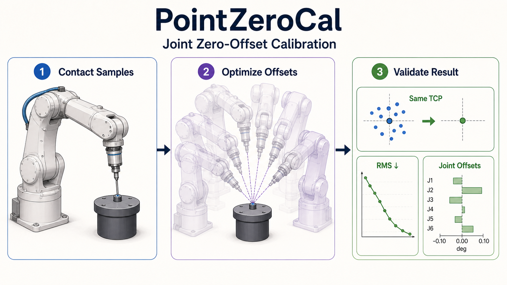
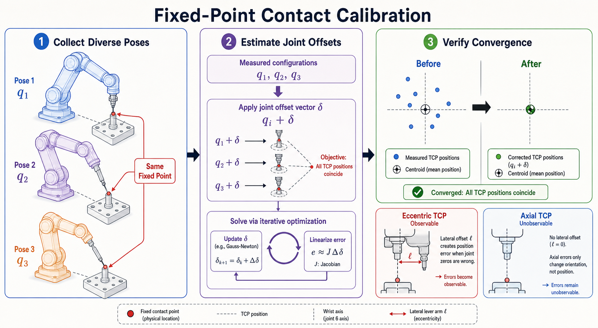
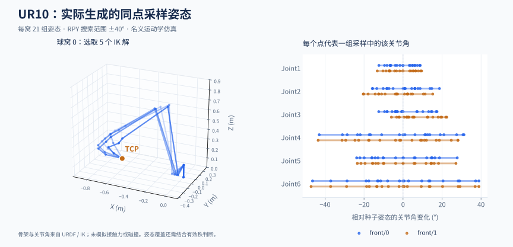
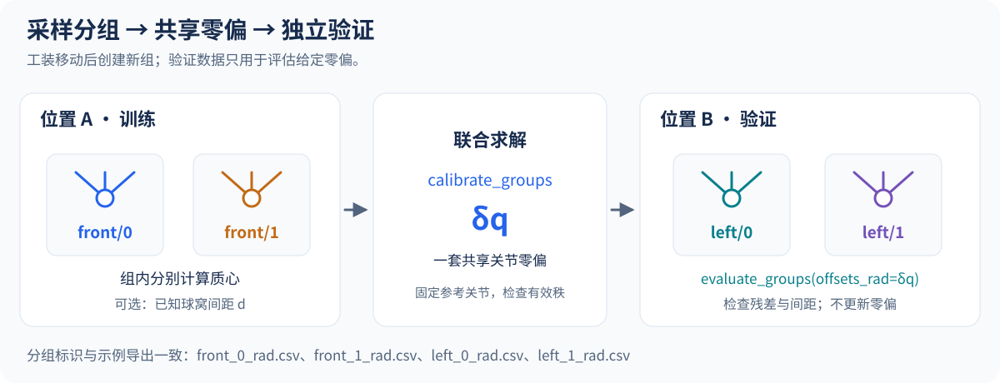

# 使用指南

[项目概览](../README.zh-CN.md) · [English](usage.md)

PointZeroCal 是基于 [Pinocchio](https://github.com/stack-of-tasks/pinocchio) 的机器人关节零位偏差标定库。它利用 TCP 接触固定点时采集的多组关节角，估计编码器零偏；支持多个球窝分组、已知球窝间距约束，以及独立位置上的固定参数验证。

[采样图解](#采样图解) · [数据要求](#数据要求) · [多接触点与已知间距](#多接触点与已知间距) · [UR10 仿真](#ur10--viser-仿真验证)



## 为什么选择 PointZeroCal

- **求解器与后端解耦：** 可直接使用 Pinocchio 适配器，也可实现精简的位置与雅可比接口。
- **可观性诊断完整：** 输出有效秩、奇异值、条件数和活动关节，明确提示欠约束标定。
- **工程接口实用：** 提供类型标注 Python API、严格 JSON CLI 输出、角度/弧度输入、固定关节和 TCP 变换。
- **双球窝联合求解：** 各接触组分别中心化，共享零偏，并可加入已知间距约束。
- **验证可复现：** 包含确定性的解析模型测试、轴向/偏心 TCP 对照，以及含噪双球窝的跨位置验证。

## 标定原理

采集多组 TCP 接触同一物理点时的分散机器人姿态。求解器迭代估计一组共享关节零偏，使修正后的 TCP 位置相对于共同质心的残差最小。同点位置测量无法辨识整体基座旋转，因此必须固定一个参考关节。



## 安装

```bash
python -m pip install -e .
# 开发与测试
python -m pip install -e '.[test]'
pytest
```

## 快速开始

无需启动可视化界面即可运行仓库内置的 UR10 示例：

```bash
python -m pip install -e .
python examples/ur10_calibration_demo.py --no-viewer
# 双球窝采样、含噪标定与另一位置独立验证
python examples/ur10_two_socket_demo.py
```

## 采样图解


1. **定义球心 TCP。** 将球头牢固安装在末端，模型的 TCP 平移应指向球心；一组采样期间工装位置保持固定。
2. **采集球窝 0。** 球头稳定落座、机器人静止后，记录全部可动关节角。改变末端姿态并重复采样，覆盖不同的关节组合。
3. **采集球窝 1。** 使用同一球头，另存一组 CSV。若使用距离约束，记录实测球窝中心间距；图中的 50 mm 是仿真示例值。
4. **留出独立位置。** 移动工装并创建新的组名，用于评估训练得到的零偏。验证时参数保持固定。

`fixed_joints` 固定的是**待估零偏**；采样时这些关节仍可运动，CSV 中也必须包含它们。落座间隙、未静止采样或接触力造成的变形会影响同点假设，应结合记录复查较大残差。



上图由仓库 URDF 和 IK 实际计算生成，使用偏心 TCP `(0.08, 0, 0.16) m`。双球窝示例每窝生成 21 组姿态，RPY 搜索范围为 ±40°；骨架图仅展示球窝 0 的五个解。它展示运动学采样，不模拟实物接触力或碰撞。SVG 可放大查看，[配图来源与重生成方式](assets/README.md)随仓库保存。

| 采样检查 | 如何判断 |
| --- | --- |
| 姿态是否充分 | 查看关节覆盖、有效秩和奇异值；21 组是示例配置，API 每组至少两条只是输入要求。 |
| 是否存在不可观关节 | 同点位置约束保留基座旋转自由度；球心落在末轴轴线上时，该轴零偏也不可观。 |
| 哪些样本需复查 | 查看各组逐样本残差和 `worst_sample_csv_row`，结合落座、静止状态与采集记录判断。 |
| 是否能用于其他位置 | 固定估计零偏，在独立位置比较修正前后 RMS 和距离误差。 |

## 数据要求

CSV 每行是一组关节角。无表头时，列顺序必须与 URDF 的可动关节顺序一致；首个数据行为关节名时，添加 `--csv-header`，程序会按名称重排为模型顺序，并拒绝缺失、重复或未知关节名。表头必须显式指定，避免误跳过第一条数值样本。

读取器支持 UTF-8（含 BOM）、带引号字段、空行和引号外的 `#` 注释；每组关节角占一个物理行。数值错误会指出原文件行号、列号和关节名。实际标定应采用分布充分的姿态来保证可观性。同一组样本必须接触同一个静止物理点；多个接触点可通过 `calibrate_groups` 分组求解，CLI 支持单接触点 CSV 和命名接触组。

对单组且没有距离约束的数据，重复同一姿态的有效秩为 0，即使只估计一个关节也是如此。多组之间的已知距离可以提供额外约束。样本、零偏初值和后端输出必须为实数，复数或非有限输入会明确报错。

## 命令行

```bash
point-zero-cal \
  --urdf robot.urdf \
  --end-frame tool_tip \
  --tcp-xyz 0.08 0.0 0.16 \
  --samples contact_samples.csv \
  --unit deg \
  --fixed-joint joint1
```

若 CSV 首行为 `joint2,joint1,...` 等关节名，添加 `--csv-header` 即可按名称对齐。MUKCa 的 ROS 2 采集器导出相同的命名表头格式，关节集合与模型一致时可读取；录制的旋转关节位置应使用 `--unit rad`。兼容范围见[设计对照](kinematics_calibration_design_review.md)。

结果默认打印到终端，不写入文件；需要保存时添加 `--output calibration.json`。`--tcp-xyz` 指定 TCP 在末端 frame 下的平移，`--tcp-rpy` 指定其弧度制姿态。同点接触无法辨识整体基座旋转，因此默认固定第一个可动关节。可重复使用 `--fixed-joint` 覆盖默认值。返回码 0 表示收敛，2 表示未收敛或有效秩不足。

CLI 默认输入为角度，Python API 默认为弧度。可通过 `--residual-tolerance` 设置测量条件允许的点云 RMS，单位为**米**；例如 `--residual-tolerance 0.0001` 表示 0.1 mm。另支持 `--step-tolerance`（弧度）、`--damping`、`--rank-tolerance`（相对奇异值阈值）及 `--max-iterations`。容差必须为有限正数，阻尼可为零，秩阈值必须小于 1。输入错误或文件写入失败时返回 2，并向 stderr 输出错误说明。秩不足或条件数超出浮点范围时，JSON 中的条件数为 `null`；请结合 `rank` 判断是否满秩。

`--output` 不能与样本 CSV 或 URDF 指向同一文件，包括通过软链接或硬链接引用输入文件。JSON 报告先完整写入目标目录中的临时文件，再原子替换；写入失败时原有报告保持完整，目标目录需事先存在。已有报告的权限和软链接会保留。

多接触组模式以可重复的 `--group NAME=PATH` 替换 `--samples`，并可选加入已知间距与独立验证组：

```bash
point-zero-cal --urdf robot.urdf --end-frame tool_tip --tcp-xyz 0.08 0.0 0.16 --unit rad \
  --group front0=front_0_rad.csv --group front1=front_1_rad.csv \
  --distance front0 front1 0.05 \
  --validate-group left0=left_0_rad.csv --validate-group left1=left_1_rad.csv \
  --validate-distance left0 left1 0.05
```

`--group-sigma NAME=SIGMA` 与 `--distance-sigma FIRST SECOND SIGMA` 提供可选的米制一σ不确定度；`--distance-weight FIRST SECOND WEIGHT` 设置正距离权重。`--csv-header` 对所有 CSV 生效，训练与验证组名必须互不重复。验证组以拟合后的零偏固定评估，不重新拟合；报告增加 `validation_evaluation` 与 `validation_passed`，仅当拟合收敛且（存在验证组时）验证通过才返回 0。

## Python API

```python
import numpy as np
from point_zero_cal import JointZeroCalibrator, PinocchioKinematics, load_samples_csv

kinematics = PinocchioKinematics("robot.urdf", "tool_tip", tcp_xyz=(0.08, 0.0, 0.16))
table = load_samples_csv("contact_samples.csv", kinematics.joint_names)
samples = table.values
result = JointZeroCalibrator(kinematics).calibrate(
    samples, sample_unit="deg", fixed_joints=["joint1"]
)
print(result.converged, result.offsets_deg)
# 将估计零偏加到实测关节角上，得到修正后的弧度值。
corrected_rad = np.deg2rad(samples) + result.offsets_rad
```

读取命名表头时，为 `load_samples_csv` 添加 `header=True`。返回的 `SampleTable` 包含按模型关节顺序排列的只读 `values`、`joint_names`，以及从 1 开始的原文件物理行号 `csv_rows`。读取器保留输入单位，标定时通过 `sample_unit` 指定；数值 API 仍可直接接收数组。

当前支持固定基座、每个可动关节一个配置变量的有限位旋转关节 URDF 模型。浮动基座、多自由度关节及采用多变量配置的连续旋转关节会明确报错。由于标定 API 的所有零偏均以弧度表示，移动关节也会被拒绝，避免混用长度和角度单位。

标定结果包含状态说明、样本数、活动关节、标定前后点云 RMS、有效秩、条件数和奇异值。算法在最终更新后重新计算诊断量，并校验输入形状、非有限数值、TCP 参数和 Pinocchio 后端输出。

单点 `calibrate` 还会返回 `sample_diagnostics`，利用缓存位置计算，无需额外调用运动学。只读数组包括 `contact_point_xyz`（后端世界坐标系下的最终样本质心）、`initial_point_errors` 和 `corrected_point_errors`，单位均为米。残差保持输入样本顺序，初始残差包含零偏初值的影响。`max_corrected_point_error` 和 `worst_sample_index` 指出最大修正后残差及其位置；索引**从 0 开始**，示例终端报告的样本编号则从 1 开始。最大残差提示需复查的样本，是否接触异常应结合采集记录判断。

Python API 可使用 `result.to_dict()` 导出与 CLI 一致的诊断信息，例如导入 `json` 后调用 `json.dumps(result.to_dict(), allow_nan=False)`；CLI 另附完整的 `joint_names` 和 `sample_csv_rows`，并在 `sample_diagnostics` 中添加 `worst_sample_csv_row`。CSV 行号从 1 开始，计入表头、注释和空行，可直接定位原文件中的样本。嵌套 JSON 字段通过 `_m` 后缀明确米制单位：`contact_point_xyz_m`、`initial_point_errors_m`、`corrected_point_errors_m` 和 `max_corrected_point_error_m`。

`step_norm` 表示**返回零偏处，估计仍需修正的未加阻尼步长**的无穷范数，单位为弧度。最后一次允许的更新到达解时可正确报告收敛，也避免大阻尼仅因压小更新量而误报成功。计算质心前先消去公共基准，RMS 则通过缩放累加求得，避免舍入误差产生虚假可观秩，以及直接平方造成的上溢或下溢。

求解使用带阻尼的 SVD 更新，求解与诊断采用同一可观性阈值；若更新会增大点云 RMS，则缩短步长重新尝试。含噪数据达到稳定解后会提前停止，但只有秩、残差和步长条件全部满足时，`converged` 才为真。算法属于局部求解，仍需充分分散的姿态和合理初值。`initial_offsets` 始终使用弧度，与样本单位无关；固定关节保留其初始零偏。结果数组为只读，需要修改时请先调用 `.copy()`。

自定义后端实现 `dof`、`joint_names` 和 `position_and_jacobian(q)`，返回 `(3,)` 的米制位置与 `(3, dof)` 的 m/rad 雅可比；允许在多次调用间复用输出缓冲区。Pinocchio 后端另提供 `tcp_pose_and_jacobian(q)`，一次返回 TCP 位姿和与世界坐标轴对齐的 `(6, dof)` 雅可比，前三行为线速度部分，可用于仿真和诊断。

关节标定可使用可选的 `position_and_jacobian_batch(configurations)`：输入形状 `(N, dof)`，返回位置 `(N, 3)` 和 Jacobian `(N, 3, dof)`。标定器校验并复制返回数组；Pinocchio 一次校验整批输入，并保留子类对标量方法的覆盖行为。仅实现标量接口的后端仍可使用。

## 多接触点与已知间距



每个工装位置的每个静止球窝使用独立 `ContactGroup`。各组拥有各自质心，共同估计一套关节零偏；TCP 变换应指向球心。移动工装后创建新组，所有组使用模型关节顺序和统一样本单位。

以下完整示例从仓库根目录运行。先生成四组带关节名的弧度 CSV 和一份合成数据报告：

```bash
python examples/ur10_two_socket_demo.py --output-dir two_socket_output
```

```python
from pathlib import Path
from point_zero_cal import (
    ContactGroup,
    JointZeroCalibrator,
    KnownDistance,
    PinocchioKinematics,
    load_samples_csv,
)

kinematics = PinocchioKinematics(
    "assets/UR10/UR10.urdf", "ee_link", tcp_xyz=(0.08, 0, 0.16)
)
data_dir = Path("two_socket_output")


def read_contact(name, filename):
    table = load_samples_csv(data_dir / filename, kinematics.joint_names, header=True)
    return ContactGroup(name, table.values, csv_rows=table.csv_rows)


training = [
    read_contact("front/0", "front_0_rad.csv"),
    read_contact("front/1", "front_1_rad.csv"),
]
solver = JointZeroCalibrator(kinematics, residual_tolerance=0.0001)
result = solver.calibrate_groups(
    training,
    distances=[KnownDistance("front/0", "front/1", distance_m=0.05)],
    sample_unit="rad",
    distance_tolerance=0.0001,
)
if not result.converged:
    raise RuntimeError(result.message)

validation = [
    read_contact("left/0", "left_0_rad.csv"),
    read_contact("left/1", "left_1_rad.csv"),
]
validation_distances = [KnownDistance("left/0", "left/1", distance_m=0.05)]
nominal = solver.evaluate_groups(
    validation,
    offsets_rad=[0] * kinematics.dof,
    distances=validation_distances,
)
check = solver.evaluate_groups(
    validation,
    offsets_rad=result.offsets_rad,
    distances=validation_distances,
)
print(
    "Validation RMS (mm):", nominal.point_rms_m * 1000, "->", check.point_rms_m * 1000
)
print("Distance error (mm):", check.distances[0].error_m * 1000)
```

将 0.05 m 替换为实际测量的球窝中心间距。距离约束可选，`weight` 为正的无量纲平方残差权重，默认 1。平方目标为 `mean(group_point_rms_m**2) + sum(weight * distance_error_m**2)`，每个接触组整体权重相同，不因样本数量多而占据更大比重。分组求解复用已有 SVD 与回溯；单组且没有距离约束、未设置 `sigma_m` 时，与 `calibrate` 使用完全相同的求解过程。单组设置 `sigma_m` 后也使用加权系统，影响阻尼和报告的奇异值；物理残差容差仍以米计。

可选 `sigma_m` 字段描述米制一σ测量不确定度：`ContactGroup(..., sigma_m=...)` 降低噪声较大组的残差权重，`KnownDistance(..., sigma_m=...)` 将距离残差除以 σ。`None`（默认）保持上述等权行为。收敛验收始终检查未加权的物理误差，因此大 σ 无法掩盖超差的组或距离。σ 会出现在评估报告与 JSON 输出中，候选排序同样遵循 σ 加权。

收敛要求活动参数满秩、剩余零偏修正足够小、**每组**点云 RMS 不超过 `residual_tolerance`，且**每条未加权距离误差**不超过 `distance_tolerance`（默认等于残差容差）。减小权重不会掩盖超限的距离误差。组名必须唯一，距离两端需引用不同的已有组；正距离约束的预测质心重合时无法线性化，需要调整初值或检查数据。

分组结果的 `initial_evaluation` 和 `evaluation` 会一并写入 `to_dict()`。其中 `groups` 包含质心、点云 RMS、逐样本误差和可选 CSV 行号；`distances` 包含“预测间距减去实测间距”的有符号误差。`corrected_point_rms` 对各组等权汇总，`residual_rms` 另计入距离项；`sample_diagnostics` 保留给单点 API。

`evaluate_groups` 固定给定零偏，不进行参数优化。应使用独立工装位置或采集批次，在同一验证数据上比较名义参数与标定参数。验证质心由该组样本推算，因此报告衡量接触一致性及相对间距，不等同于有独立世界基准的绝对 TCP 精度。距离约束仍保留整体坐标系自由度，也无法让轴向 TCP 感知末轴旋转。几何（URDF origin）参数拟合是独立的模型，见下一节。

默认合成数据的独立验证点云 RMS 约从 3.40 mm 降到 0.0363 mm，这是仿真结果。可用 `--encoder-noise-deg 0` 检查无噪情形，或用 `--orientation-count 31` 修改每窝姿态数。仿真函数 `generate_fixed_point_dataset(..., target_xyz=...)` 支持指定米制接触位置。

## 几何（URDF origin）标定

关节零偏与安装/连杆 origin 偏差是两个独立模型。`GeometricCalibrator` 用同一套分组接触数据拟合所选 URDF `<origin>` 分量的偏差（x/y/z 米制平移、roll/pitch/yaw 弧度制旋转），支持逐参数活动掩码、先验尺度与可选边界：

```python
from point_zero_cal import (
    GeometricCalibrator,
    GeometricParameter,
    KnownDistance,
    PinocchioGeometricKinematics,
    export_calibrated_urdf,
    geometric_origin_updates,
)

backend = PinocchioGeometricKinematics(
    "robot.urdf",
    "tool_tip",
    [GeometricParameter("tool_mount", c, prior_scale=0.1) for c in ("x", "y", "z")],
    tcp_xyz=(0.08, 0.0, 0.16),
)
fit = GeometricCalibrator(backend, residual_tolerance=0.0001).calibrate_groups(
    training, distances=[KnownDistance("front/0", "front/1", 0.05)]
)
export_calibrated_urdf(
    "robot.urdf",
    "robot_calibrated.urdf",
    geometric_origin_updates("robot.urdf", fit.parameters),
    metadata={"message": fit.message, "converged": fit.converged},
)
```

`GeometricParameter` 携带所属关节、分量、单位、`nominal`（偏差基准，默认 0）、`active` 掩码、必填正 `prior_scale`（以分量单位计）与可选 `lower`/`upper` 边界。参数可指向旋转关节或单层 fixed joint（典型工具安装）；链式 fixed joint 因折叠后的 placement 不再对应单一 origin 而在构造时报错。后端提供解析 TCP 导数，测试中已对照重建扰动 URDF 逐一验证。

Pinocchio 几何后端提供 `position_and_geometric_jacobian_batch(configurations, parameters)`：输入形状分别为 `(N, dof)` 和 `(n_parameters,)`，输出形状为 `(N, 3)` 和 `(N, 3, n_parameters)`。整批样本共用一次 origin 偏差准备，完成或异常退出后恢复模型。`GeometricCalibrator` 检测到这一可选方法时会自动使用，并校验、复制返回数组；仅实现逐样本方法的自定义后端仍可使用。

生成独立验证报告时，`evaluate_groups` 使用关节零位后端可选的 `position_batch(configurations)` 或几何后端可选的 `geometric_position_batch(configurations, parameters)`。两者返回以米为单位的 `(N, 3)` 位置。Pinocchio 实现跳过 Jacobian 计算，报告数值保持一致；自定义后端仍可使用原有的位置与 Jacobian 联合求值方法。

目标函数为每个活动参数追加一条归一化先验行 `(x - nominal) / prior_scale`，与距离行同尺度；可观性诊断（`data_rank`、`data_condition_number`、`singular_values`、`nullspace_directions`）只使用接触组与距离行，先验行绝不进入秩诊断。收敛要求数据秩满、各组 RMS 与距离误差达标、剩余步长足够小且未停滞。边界裁剪被接受的候选步。`evaluate_groups` 以固定参数向量评估留出组，不运行优化。

固定点一致性只能通过参数的非刚体 TCP 效应观察安装误差，因此先验经雅可比与数据竞争：宽松的 `prior_scale` 让接触数据主导，收紧则把参数拉向名义值；报告中的数据奇异值量化了这一杠杆。零偏与安装旋转从不联合估计——绕关节自身轴的 origin 旋转与该关节零偏严格等价。

`export_calibrated_urdf` 写入新文件（源文件不变），保留 XML 注释，只以绝对值重写所选 origin 分量，并把参数、求解状态与验证结果以转义 JSON 的 XML 注释内嵌，导出的模型仍可被标准 URDF 解析器加载。运行 `python examples/ur10_geometric_demo.py` 可复现合成双球窝对 TCP 安装平移误差的恢复，含先验收紧对比、独立位置验证与标定 URDF 导出。

## UR10 + Viser 仿真验证

仓库提供基于 `assets/UR10/UR10.urdf` 的两组对照案例。两者都固定 TCP 的 XYZ、改变 RPY，并通过 Pinocchio IK 生成姿态。默认使用 41 个 ±60° 范围内的分散姿态；横向 TCP 案例的六关节跨度约为 `[35°, 47°, 44°, 115°, 96°, 147°]`。

- 轴向 TCP `(0, 0, 0.16)`：Joint6 不可观；固定 Joint1/Joint6，验证 Joint2–Joint5。
- 横向偏心 TCP `(0.08, 0, 0.16)`：`X=0.08 m` 是垂直于第六轴的力臂，使 Joint6 的平移雅可比非零；仅固定 Joint1，验证 Joint2–Joint6。

安装仿真依赖：

```bash
python -m pip install -e '.[simulation]'
```

只运行标定并打印结果，不保存文件：

```bash
python examples/ur10_calibration_demo.py --no-viewer
```

启动 Viser，通过 `TCP case` 下拉框和 `Contact pose` 滑块查看案例：

```bash
python examples/ur10_calibration_demo.py
```

点位数必须是大于等于 3 的奇数，可调整数量和姿态范围：

```bash
python examples/ur10_calibration_demo.py \
  --no-viewer \
  --orientation-count 49 \
  --orientation-range-deg 45
```

如果 TCP 位于 Joint6 轴线上，仅靠固定点 XYZ 无法辨识 Joint6，需要横向偏心工具或额外姿态测量。标定器使用相对奇异值阈值，避免将浮点噪声误认为有效可观秩。

示例故意向 Joint2–Joint6 注入 `[+1.2°, -0.8°, +1.5°, -1.0°, +2.0°]` 零偏。横向 TCP 案例可以恢复全部五项，并将点云 RMS 从约 `4.57 mm` 降至数值精度；轴向 TCP 案例恢复 Joint2–Joint5，同时保留不可观的 Joint6 误差。

报告中的关键字段：

- `Injected`、`Estimated`、`Error`：注入值、估计值和估计误差。
- `State`：关节是参与标定、固定为参考，还是不可观。
- `Point RMS`：修正前后的 TCP 点云离散程度。
- `Rank`：可观关节数量。
- `Condition no.`：通常越小代表样本激励越好。

### 可选：导出结果

只有显式提供 `--output-dir` 才会写文件：

```bash
python examples/ur10_calibration_demo.py \
  --no-viewer \
  --output-dir calibration_output
```

输出包括两种案例的 `*_measured_deg.csv` 模拟编码器采集值，以及 `*_result.json` 标定报告。

## 设计参考

[kinematics_calibration 设计对照](kinematics_calibration_design_review.md)记录了 MUKCa 的球头/双球窝采样、分组接触、已知间距约束、几何参数及独立验证思路，并区分当前已实现功能与后续扩展顺序。
